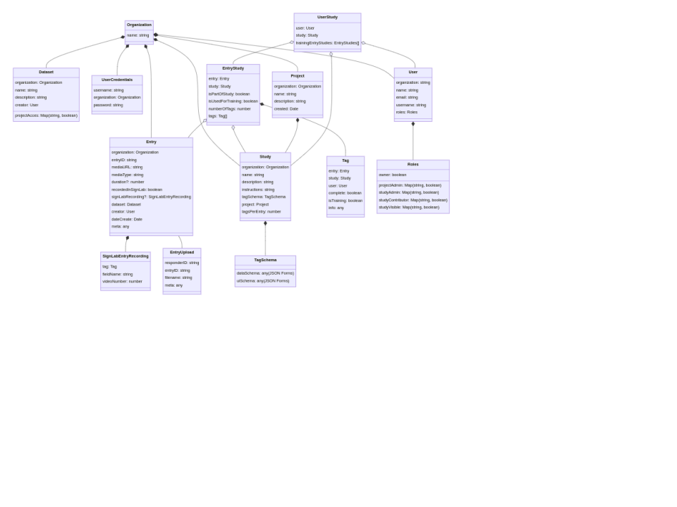
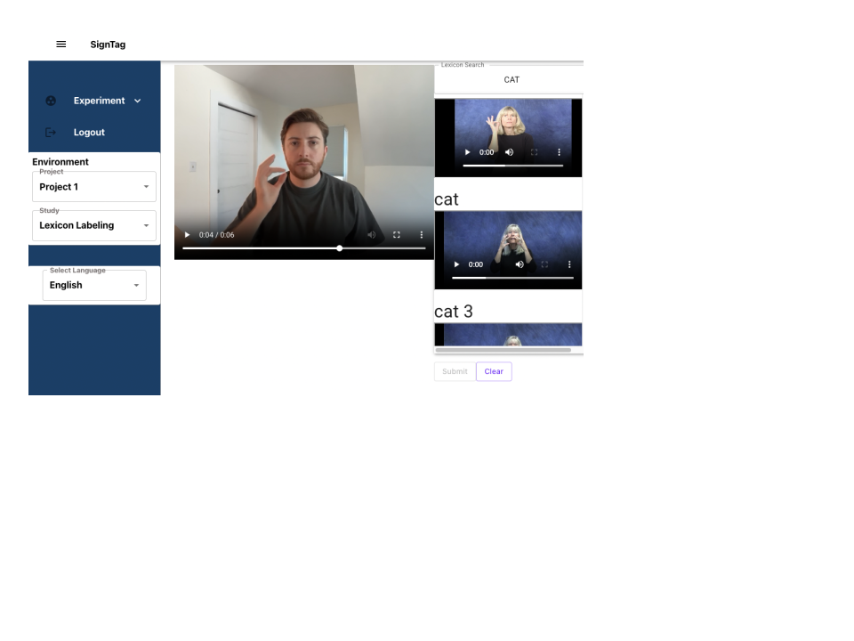

# Summary

High quality language data is the foundation of technologies that recognize, generate, and translate human language, and is also extremely valuable for linguistic research. However, the ability to create datasets of this sort has been prohibitively challenging for signed languages. Such languages are visual and do not have conventional written systems, which makes machine-readable, text-based labels cumbersome and often inadequate. SignTag addresses this by allowing rapid data collection and annotation of sign languages using sign language-based labels. Research teams can invite users to iteratively contribute data of various types to a dataset. Supported data types include video and standard metadata fields such as free text, numeric values, categorical labels, and boolean flags. A central innovation of SignTag is that it allows users to label data by choosing an entry from a sign language lexicon, replacing the need for text-based labels.

# Statement of Need

The development of spoken and written language technologies have made it possible to access greater amounts of information, conduct interactions, and navigate systems and institutions in ways that have never been possible before. Sign language technologies, by comparison, lag behind. This is largely because language technology depends on data, and machine-readable sign language data has been especially challenging to collect. Even the most well-documented sign languages are low-resource languages, and in these cases, data quality is critical. 

The shortage of data arises in part because sign languages are visual languages and do not have conventional writing systems. Sign language data requires video recordings of signers, not just text or audio, paired with structured labels that capture what is being signed, how it is signed, and by whom. One solution to the shortage of data is to scrape data from public sources, but these data are messy, participants may not have consented or been compensated, and often lack reliable labels. While scraped data may be tolerable for some applications, for other applications the quality of the data is unacceptable. 

High quality language data often requires datasets that are “lemmatized” meaning all examples of the same sign (a lemma) receive the same label, and other signs do not use that label.

This has been a persistent challenge in sign language research. One approach to labeling sign language data is to use written glosses (i.e., translations), but this can prove challenging for lemmatization [@fenlon2015bslsignbank]. Taking American Sign Language (ASL) as an example, an ASL sign may correspond to more than one English label (e.g., the same sign might be translated as CONNECT or BELONG depending on context) or no English label (e.g., verbs in ASL can describe properties of objects or events in ways that often require at least a full English sentence to translate), and vice versa English labels may correspond to multiple ASL signs (e.g., the English word *run* corresponds to multiple ASL signs that mean jogging, operating a business, or a dripping faucet). Aside from the practical challenges of lemmatizing signs, representing signs with written labels reproduces social ideologies that favor written/spoken language, a significant concern when deaf and hard of hearing communities routinely face linguistic discrimination and a lack of opportunities to learn and use sign language [@desai2024systemic].  

Another solution to the high quality data problem is to use one of a number of notation systems that represent aspects of the phonological forms of signs, such as HamNoSys [@hanke2004hamnosys; @arkushin2023ham2pose] or SignWriting [@sutton1999signwriting; @jiang2023signwritingmt]. These systems label a sign by identifying things like its handshape, place of articulation, movement, etc. Such efforts are often inefficient and require a great deal of specialized training. A key innovation we propose here is labeling sign language data with sign language labels, rather than a printed intermediary.

# State of the Field

Publicly available tools for annotating sign language currently include ELAN [@crasborn2008elan], a widely used multimedia annotation software, as well as sign language-specific options such as SignStream [@neidle2001signstream] and iLex [@hanke2002ilex]. However, these options are designed primarily for text-based annotation rather than for annotating sign language data directly with sign language. Although it is possible in ELAN to link a sign language corpus as a lexicon service and use it as an external controlled vocabulary [@hochgesang2021signbankelan], setup is not straightforward and requires users to download the full corpus locally.

These tools are also built for annotating existing recordings, not for supporting the elicitation of new data to be annotated. This creates additional technical barriers for researchers who want to collect sign language data in formats that are ready for annotation. For example, researchers eliciting signed lexical data need to use a separate system to present prompts and record participants’ responses, then import, organize, and link those videos in annotation software afterwards. The existing tools are designed to create many temporally synchronized annotations of extended excerpts of sign language, and can be cumbersome for labelling a high volume of short video segments that include a single sign or short utterance. SignTag addresses these gaps by providing an integrated interface for eliciting and annotating sign language data using sign language. 

# Software Design

SignTag’s objectives require having multiple users contributing to data labeling simultaneously, labeling with standardized sign lexicons and maintaining large volumes of videos. With these considerations in mind, the system was decided to be built as a web application with a strict client/server design. 

The backend handles access control, verifying data labels, and synchronizing the labeling process across hundreds of users. The frontend provides a UI for creating resources against the backend, accessing data, and rendering the data labeling process. This separation allows for collecting at scale while ensuring data integrity.

The system was designed to allow multiple research organizations to use the same instance of SignTag. The entity relation diagram below encapsulates the design of the platform as a whole. A hierarchical separation between “Organizations”, “Projects”, and “Studies” allow for access control logic. “Datasets” and “Entries” provide a means to identify the data that is being labeled in a “Study”. Each label is captured as a “Tag”. Each “Study” can require users to label “Entries” differently based on the “TagSchema” for the “Study”.

Researchers using SignTag start by uploading a seed dataset made up of either videos or images. SignTag supports labeling with multiple fields at once which can be typical data fields (e.g., free text, numeric, categorical, boolean flags), or they can be data types that are particularly useful for sign language data collection: video, and “sign lexicon.” The video type allows a user to record a video (of themself signing, for example) that then gets associated with the prompt. The sign lexicon type allows a user to select a label from a dictionary of signs. The online sign lexicon is critical as it allows labeling signs uniquely and provides interoperability between different datasets.

The structure of each “Tag” is maintained via JSONForms which is a JSON Schema based approach for creating and representing forms. When labels are being collected, the user interface handles rendering each field. The backend handles converting each field into a database friendly format. This frontend rendering and backend storage conversion enables working with video-to-video and sign lexicon based labeling which is typically not supported by sign labeling tools. The data can then be exported from the platform where each field is converted into a CSV representation and each video is also downloaded. SignTag is designed specifically for reusability, so the process of creating studies, and even using the data generated in SignTag as the next dataset to be labeled, can be repeated as often as is needed.

# Research Impact Statement

SignTag has already enabled the creation of some of the largest publicly available sign language datasets [e.g., @kezar2023semlex]. Teams working on sign languages in Spain and Kenya are currently using the system to generate similarly large datasets. It offers researchers and developers working on sign languages an efficient way to collect and label large volumes of isolated signs.

# AI Usage Disclosure

The original code base has no AI generated content. Some refactoring with Anthropic’s Claude has been used. An LLM was used for light editing of the manuscript.

# References

